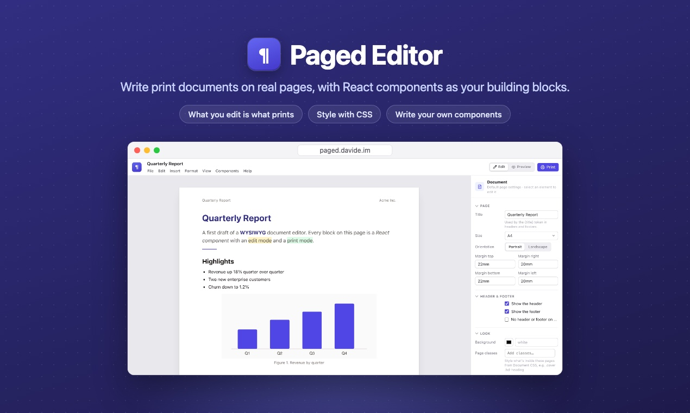
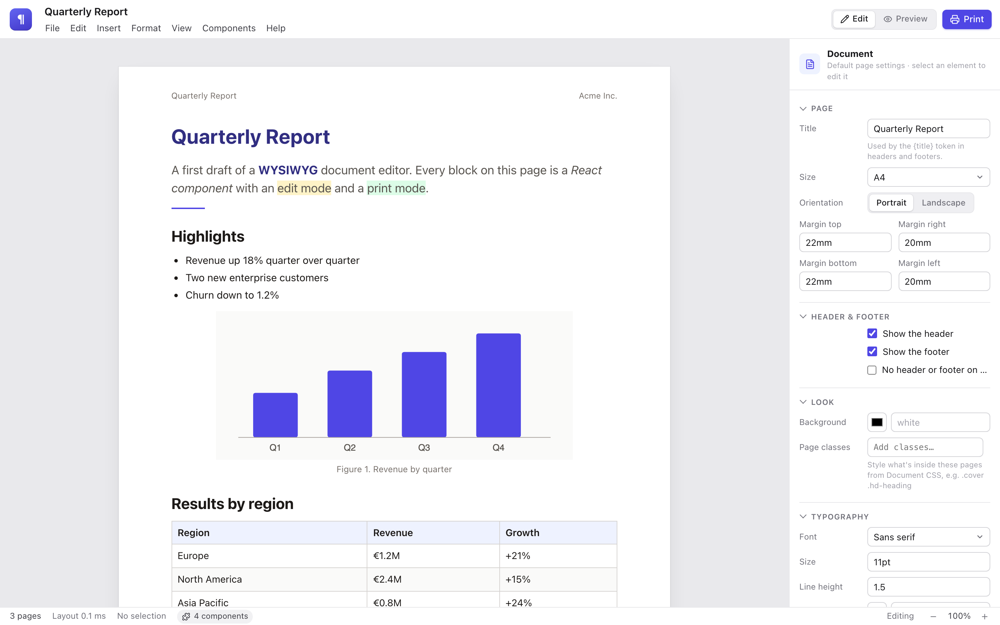
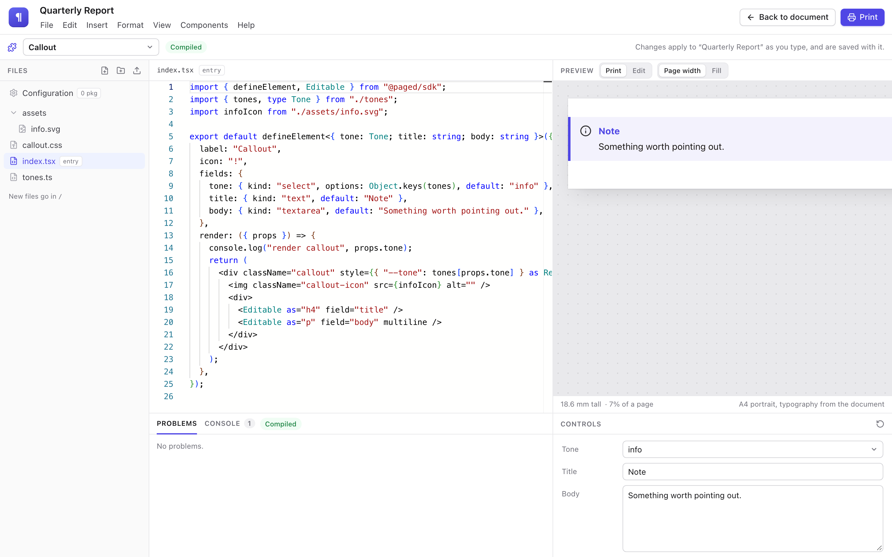

<div align="center">

# Paged Editor

**Write print documents on real pages, with React components as your building blocks.**

Every element on the page is a React component: use the built-in ones or write your own, style them
with CSS, and print or save to PDF. Pages lay out as you type, and what you edit is what prints.
It runs in the browser, with no backend.




[Try it](https://paged.davide.im) · [Quick start](#quick-start) · [Features](#features) · [Custom components](#custom-components) · [How it works](#how-it-works) · [Known limits](#known-limits)

</div>

## What it is

<div align="center">

</div>

Paged Editor is a WYSIWYG editor for documents that are printed or saved as PDF. The aim is to
write documents with web technologies: pages are rendered as HTML, elements are styled with CSS, and
anything the built-in elements don't cover can be written as a React component and saved with the
document.

Each element on the page (heading, paragraph, list, table, image or custom component) is a React
component with an edit mode and a print mode. Edit, Preview and print use the same page layout,
computed by a custom paginator (not Paged.js). The interface has a menu bar, context menus, an
inspector, a status bar with zoom, and keyboard shortcuts.

## Features

- **Pages.** A4, A5, Letter or Legal, portrait or landscape. Paragraphs split across pages by line,
  lists by item, and tables by row with the header repeated.
- **CSS.** Every element can have classes. Styles come from Document CSS, per-section Page CSS and
  each element's own styles, scoped so they don't affect the editor.
- **Custom components.** Written in the component studio (code editor, preview, controls, console).
  They can import pinned npm packages and are saved inside the `.pdoc` file.
- **Sections.** A range of pages can have its own size, orientation, margins, header and footer,
  background and CSS.
- **Header and footer.** The page margins hold any elements, including page number and title.
- **Files.** Documents autosave in the browser and save as `.pdoc` (a zip). Opening and saving on
  Google Drive is optional.
- **Speed.** On a 67-page test document, a pagination pass after an edit takes about 1 to 3 ms
  (measured locally, dev build).
- **No backend.** The app is static files. It has no accounts and no telemetry.

## Quick start

> **Requirements:** Node.js 22 (the version CI uses) and pnpm 10. A hosted build is at <https://paged.davide.im>.

**1. Install dependencies**

```sh
pnpm install
```

This also generates the shared React runtime that custom components import (`public/runtime/`).

**2. Start the editor**

```sh
pnpm dev
```

Open the URL Vite prints. The first time, the editor loads the **Quarterly Report** sample: three
pages with formatted text, a table and four custom components (Callout, Chart, QR code, 3D scene).

**3. Try the basics**

Click text to edit it. Select words to show the format bar. Right-click a page or an element for
its menu. ⌘/ lists the keyboard shortcuts; ⌘P prints or saves as PDF.

**4. (Optional) Connect Google Drive**

```sh
cp .env.example .env.local
```

Fill in the three `VITE_GOOGLE_*` values and restart `pnpm dev`.
The Google Cloud setup is in [docs/google-drive.md](docs/google-drive.md).

## Using it

### Shortcuts

Every action is defined once in [`src/editor/commands.tsx`](src/editor/commands.tsx), so the menus,
right-click menus and shortcuts match. ⌘ is Ctrl on Windows and Linux.

| Keys | Action |
|---|---|
| ⌘O · ⌘S | Open a `.pdoc` · save (to Drive when the document came from Drive) |
| ⇧⌘O · ⇧⌘S | Open from Google Drive · save to Google Drive as… |
| ⌘P | Print / save as PDF |
| ⌘Z · ⇧⌘Z | Undo · redo (typing is coalesced into one step) |
| ⌘X · ⌘C · ⌘V · ⌘D | Cut, copy, paste, duplicate the selected element |
| ⌥↑ · ⌥↓ | Move the element up or down |
| ⌥⌘C · ⌥⌘V | Copy style · paste style |
| ⌘↩ | New paragraph below the selected element |
| ⌘B · ⌘I · ⌘U · ⇧⌘X | Bold, italic, underline, strikethrough |
| ⇧⌘P | Toggle Edit / Preview |
| ⇧⌘B | Margin and padding overlay |
| ⌘\ | Show or hide the inspector |
| ⌘= · ⌘- · ⌘0 | Zoom in, zoom out, actual size |
| ⌘/ | All keyboard shortcuts |

Clicking empty space between or after elements starts a paragraph there. It
is kept only if you type into it (one undo step), otherwise it disappears. Enter at the end of a
heading also starts a paragraph below.

### Built-in elements

Heading, Text, List, Table, Image, Divider, Spacer, Page break, and **Page number & title**
(left/centre/right text with `{page}`, `{pages}` and `{title}` tokens). Insert them from the Insert
menu or by right-clicking.

### Common tasks

| Task | How |
|---|---|
| Make a cover page with no header or footer | Document page settings (nothing selected) → **No header or footer on the first page** |
| Put a landscape table in a portrait report | Select a page break → **Start a new section**, then set that section to Landscape |
| Show "Page 3 of 12" | Hover the page margin, click the footer zone, insert **Page number & title** with `Page {page} of {pages}` |
| Give one section a different header | Right-click its header → **Give section N its own header** |
| Style several elements the same way | Add a class in the inspector's **Classes**, then style it in **Document CSS** (Page panel) |
| Resize table columns | Drag the column borders; double-click a border to reset |
| Check spacing | View → **Margin & padding overlay** (⇧⌘B) |

## Custom components

<div align="center">

</div>

Documents carry their own React components. **Using** one happens in the document (Insert menu or
right-click → Insert above/below, then edit its props in the inspector). **Building** one happens in
the **component studio**, opened from the Components menu, right-click → Edit component…, or the
components pill in the status bar.

| Area | What it does |
|---|---|
| Files | Tree of the component's files: code (`.tsx/.ts/.jsx/.js`), `.css`, `.json`, folders and uploaded assets (images, fonts). Create, rename, delete, upload. |
| Code | Monaco, with TSX, SDK autocompletion and compile errors as markers. |
| Preview | The component alone, Storybook-style, at the document's content width and typography, in Print or Edit mode, with its height compared to a page. |
| Controls | One input per `field`; changes only the preview. |
| Problems / Console | Compile and render errors (click to jump to the line), and anything the component logs with `console.*`. |
| Configuration | Name, entry file, and npm packages: look a package up, pick a version, pin it. |

```tsx
// index.tsx (the entry)
import { defineElement, Editable } from "@paged/sdk";
import QRCode from "react-qr-code";        // must be pinned in Configuration
import { tones } from "./tones";           // the component's own files
import logo from "./assets/logo.svg";      // assets import as URLs

export default defineElement({
  label: "QR code",
  fields: { value: { kind: "text", default: "https://example.com" } },
  render: ({ props }) => (
    <div className="qr">
      <QRCode value={props.value} size={88} />
      <Editable as="span" field="caption" />
    </div>
  ),
});
```

- **Compiling** ([`src/custom/compile.tsx`](src/custom/compile.tsx)): each code file is compiled by
  Sucrase into its own ES module (Blob URL); relative imports point at the sibling modules; `.css`,
  `.json` and assets become modules exporting their content. Every `.css` file applies to the
  document. Edits recompile after a 400 ms pause; a failed build keeps the last working version on
  the pages.
- **Packages**: bare imports resolve only to packages pinned in the component's
  Configuration, as `https://esm.sh/<pkg>@<version>?external=react,react-dom`. Anything else is a
  compile error; nothing is resolved automatically.
- **One React**: `index.html`'s import map sends `react`, `react-dom`, `react/jsx-runtime` and
  `@paged/sdk` to `public/runtime/*.js`, generated by
  [`scripts/gen-runtime.mjs`](scripts/gen-runtime.mjs), which re-export the editor's own instances.
- **Console**: each module gets its own `console` ([`src/custom/logs.ts`](src/custom/logs.ts)), so
  logs show in the studio and in devtools.
- **Trust**: components run in the editor's page with full access. That's fine for code you or your
  team write; documents from untrusted sources need a sandbox first.

### Component state

Props are what the user sets in the sidebar. **State** is what a component manages itself and must
persist, like a 3D camera. It lives on the element (`node.state`), is saved in the document (data
URLs go to `media/` in a .pdoc), and every change is an undoable edit:

```tsx
const [camera, setCamera] = useElementState("camera", DEFAULT_CAMERA);
```

Built-in elements use the same mechanism: dragging a table's column borders stores `columnWidths` in
the table's state.

Print rendering is static HTML, so anything drawn at runtime (canvas, WebGL) should save a still in
state and render that in print mode. The sample **3D scene** component (three.js) does this:
orbit/pan/zoom in Edit mode, camera and a JPEG still saved on release, the still shown in Preview and
print.

### Sample components

- **Callout**: a multi-file component (module, CSS, SVG asset).
- **Chart**: [Chart.js](https://www.chartjs.org) bar, line, area, pie and doughnut charts from
  comma/tab-separated data in the sidebar. Chart.js draws on a canvas, which static print markup
  can't carry, so the chart is drawn synchronously to an off-screen canvas at 3× resolution and shown
  as an image: the same box in Edit, Preview and print, cached per settings.
- **QR code**: `react-qr-code` from esm.sh.
- **3D scene**: three.js, orbit in Edit mode; print uses the saved still.

## How it works

```
DocumentModel (JSON, in memory + localStorage)
   │
   ├─ measure flow ── every flow element in print mode, unpaginated, hidden,
   │                  at the page content width
   │        │
   │        ▼
   │   paginate() ── reads block boxes, fills pages, splits text by line,
   │                 lists by item, tables by row (header repeats)
   │        │
   │        ▼ PageLayout[]  (which fragment of which element is on which page)
   │
   ├─ Edit ──── pages with <Component mode="edit">: type straight on the page
   ├─ Preview ─ the same pages with <Component mode="print">
   └─ Print ─── renderToStaticMarkup(pages) → hidden iframe → window.print()
```

- A document is page settings plus a flat list of `ElementNode { id, type, props, style }`; sections
  and header/footer zones are derived from that list.
- The paginator measures the **print** rendering, and the editor shows the **edit** rendering on the
  same pages. Only pages near the viewport render their content.
- A caret keeper puts your cursor back in the right place when a re-layout moves text to another page
  or remounts the fragment you're typing in.

### Sections (page settings for some pages)

Pages come out of pagination, so settings can't be tied to "page 3" (what's on it changes with every
edit). Like Word, the document is split into **sections** instead: a page break can start a section
(select it and turn on "Start a new section", or right-click a page → "Start a new section here").
Every page up to the next section break uses the document's page settings with that section's
changes:

- size, orientation, margins (sections can mix portrait and landscape)
- header and footer on/off, and no header/footer on the section's first page
- page background, page classes (for Document CSS like `.cover .hd-heading`)
- typography, and **Page CSS** that applies only inside those pages

The document's own page settings (no element selected) are the defaults; its "No header or footer on
the first page" makes a cover page.

Each section is laid out separately ([`src/layout/sections.ts`](src/layout/sections.ts)): its own
hidden measure flow at its content width, and its own page height, so text reflows when a section
changes size. Print gives each page size a named `@page` rule.

### Header and footer zones

The header and footer are **zones** of the page, not special elements: the top and bottom margins
hold any elements, built-in or custom, drawn on every page of a section. In Edit mode, hover a page
margin to see its zone; click empty space there to type, or right-click it to insert or paste into
it.

Zone elements are ordinary elements with `zone: "header" | "footer"`, kept in the document's element
list: a zone element belongs to the section it's in. A section with no header of its own shows the
previous section's (like Word's "link to previous", labelled "same as section N"); right-click →
"Give section N its own header" copies it, "Same header as the previous section" links it back.
Section settings still hide the header/footer, or skip them on a section's first page.

Zone elements don't take part in pagination, and content taller than the margin spills over the
body: make the margin bigger. Custom components can read the page they're drawn on with
`usePageInfo()` (`{ number, total }`, undefined while measured).

### Formatted text (inline runs)

A paragraph (`text` element) is a list of **runs**: pieces of text with their own marks (weight,
italic, underline, strikethrough, font, size, colour, highlight). Formatting a selection splits the
runs at its edges:

```
[the quick brown fox jumps]   select "fox", Bold
[the quick brown ][fox][ jumps]   the middle run gets { weight: "700" }
```

- [`src/model/runs.ts`](src/model/runs.ts): split, slice, replace and mark operations; neighbours
  with identical marks are merged back together.
- [`src/elements/RichText.tsx`](src/elements/RichText.tsx): the editable paragraph. Typing goes
  through the browser and is read back; Enter, paste, replacing a selection and formatting are
  applied to the runs, so the markup stays one span per run.
- Runs render as inline spans, so the paginator still splits paragraphs by line: it counts characters
  across all the spans' text nodes, and a run cut by a page break continues with the same formatting
  on the next page.

### Classes and CSS

Every element can carry CSS classes: type them into **Classes** at the top of the inspector (space,
Enter or comma turns them into pills; Backspace removes the last; suggestions come from classes
already used in the document and class selectors in Document CSS). Style them in **Document CSS**
(Page panel); per-element CSS lives in the element's **Style** tab. Both CSS boxes are Monaco editors
with completions, and apply as you type.

Cascade, lowest to highest: built-in element styles (`document.css`), component CSS, Document CSS,
section Page CSS, then the element's own styles. Each is wrapped in `@scope` with a closer root than
the one before (the document, the section's pages, the element itself), so nothing restyles the
editor and the more specific context wins at equal specificity.

### The .pdoc format

**Save .pdoc** writes a zip, like .docx:

```
mimetype                        application/vnd.paged-editor+zip (stored, first)
document.json                   page settings and elements
components/<name>-<id>/
  component.json                name, entry file, pinned npm packages
  index.tsx, lib/…, assets/…    the component's files, as written
media/<element>-<prop>.<ext>    embedded images, moved out of the JSON
```

**Open…** reads .pdoc files and older plain .json documents (single-file components and
document-wide package pins are upgraded automatically). npm packages are referenced by pinned
version, not stored in the file, so opening a document needs network access to esm.sh.

### Google Drive

**File → Open from Google Drive…** (⇧⌘O) opens a `.pdoc` from Drive with the Google Picker; **⌘S**
then saves a new revision of that file, and **Save to Google Drive as…** (⇧⌘S) creates one in a
folder you pick. It runs entirely in the browser (Google Identity Services + Drive REST API, scope
`drive.file`) and lives in [`src/drive/`](src/drive/). It needs a Google Cloud project and three
values in `.env.local`: see [docs/google-drive.md](docs/google-drive.md), which also covers Drive's
"Open with" menu over a Cloudflare tunnel.

### Performance

Measured locally on a dev build with a 67-page stress document:

- Pagination pass after an edit: about 1 to 3 ms.
- Full edit → render → layout cycle: about 10 to 14 ms, including edits on page 1 that push content
  down through every later page.
- Paged.js, for comparison, re-paginated the whole document on every change: about 270 ms at 30
  pages and about 860 ms at 100 pages.

## Repository map

| Path | What |
|---|---|
| [`src/model/`](src/model/) | The document format (`types.ts`), reducer with undo/redo and autosave (`store.tsx`), inline runs, CSS generation, `.pdoc` read/write, the sample document |
| [`src/layout/`](src/layout/) | The paginator (`paginate.ts`), sections, and caret preservation across re-layouts |
| [`src/render/`](src/render/) | Measure flow, page rendering for Edit and Preview (`PagedDocument.tsx`), and print |
| [`src/elements/`](src/elements/) | One file per built-in element, plus the registry |
| [`src/editor/`](src/editor/) | Menu bar, commands and shortcuts, inspector, format bar, context menus, status bar |
| [`src/studio/`](src/studio/) | The component studio: file explorer, code, preview, controls, configuration |
| [`src/custom/`](src/custom/) | Compiling custom components, the `@paged/sdk` they import, per-module consoles |
| [`src/drive/`](src/drive/) | Google Drive open and save |
| [`scripts/gen-runtime.mjs`](scripts/gen-runtime.mjs) | Generates `public/runtime/*.js`, the shared React runtime for custom components |
| [`docs/google-drive.md`](docs/google-drive.md) | Google Cloud and Drive setup |
| [`.github/workflows/deploy.yml`](.github/workflows/deploy.yml) | Build and deploy to GitHub Pages |

## Build and develop

```sh
pnpm typecheck
```

```sh
pnpm build
```

`pnpm build` type-checks and writes the static site to `dist/`; `pnpm preview` serves that build.
There's no automated test suite yet.

### Adding a built-in element

1. Create `src/elements/MyThing.tsx` with a component taking `ElementComponentProps<MyThingProps>`.
2. Export an `ElementDefinition` with `create()` defaults and `fields` for the sidebar.
3. Add it to `ELEMENTS` in [`src/elements/registry.ts`](src/elements/registry.ts).

Base look goes in [`src/styles/document.css`](src/styles/document.css) under `.hd-<type>`.

Rules every element component must follow: the paginator measures the **print** rendering, and the
editor shows the **edit** rendering on the same pages, so both modes must produce boxes of the same
size. Editor chrome (badges, placeholders) is absolutely positioned or fits inside the same box.
Splittable elements must render only `fragment.from` to `fragment.to`. For `split: "lines"`, print
mode must be a single text node.

### Deployment

Every push to `main` builds the app and publishes it to GitHub Pages at <https://paged.davide.im>
([`.github/workflows/deploy.yml`](.github/workflows/deploy.yml)). On GitHub, set
**Settings → Pages → Source** to *GitHub Actions* and the custom domain to `paged.davide.im`, and add
the `VITE_GOOGLE_*` values from `.env.example` as repository **variables** (Settings → Secrets and
variables → Actions → Variables). Vite inlines them into the public bundle, so they aren't secret;
the Google side is locked down by the OAuth origin and the API key's website restriction, which both
need `https://paged.davide.im` added.

## Known limits

Paged Editor is a first draft. Today:

- No links inside a paragraph yet.
- No nesting (columns). The document is a flat list; sections and zones are derived from it.
- Input methods that compose characters (e.g. Japanese input) are only checked at composition end,
  and aren't tested.
- Browser find (⌘F) only sees pages near the viewport.
- Document CSS is scoped with `@scope (.pd-doc)`; `@page` rules in it have no effect (page size and
  margins come from page settings).
- Custom components run with full access to the editor's page; there's no sandbox for documents from
  untrusted sources.
- Monaco checks syntax only in custom components (no types for npm packages or across the
  component's files yet).
- npm package code isn't stored in the .pdoc, so opening a document with custom components needs
  esm.sh.

## Credits and license

Built with [React](https://react.dev), [Vite](https://vite.dev),
[Monaco Editor](https://microsoft.github.io/monaco-editor/) (via
[@monaco-editor/react](https://github.com/suren-atoyan/monaco-react)),
[Sucrase](https://github.com/alangpierce/sucrase), [fflate](https://github.com/101arrowz/fflate),
[es-module-lexer](https://github.com/guybedford/es-module-lexer) and
[Lucide](https://lucide.dev) icons. Custom component packages are served by
[esm.sh](https://esm.sh). The sample components use [Chart.js](https://www.chartjs.org),
[three.js](https://threejs.org) and [react-qr-code](https://www.npmjs.com/package/react-qr-code).

Google Drive and Google Picker are trademarks of Google LLC; this project is not affiliated with
Google.

The repository doesn't include a license file yet.
